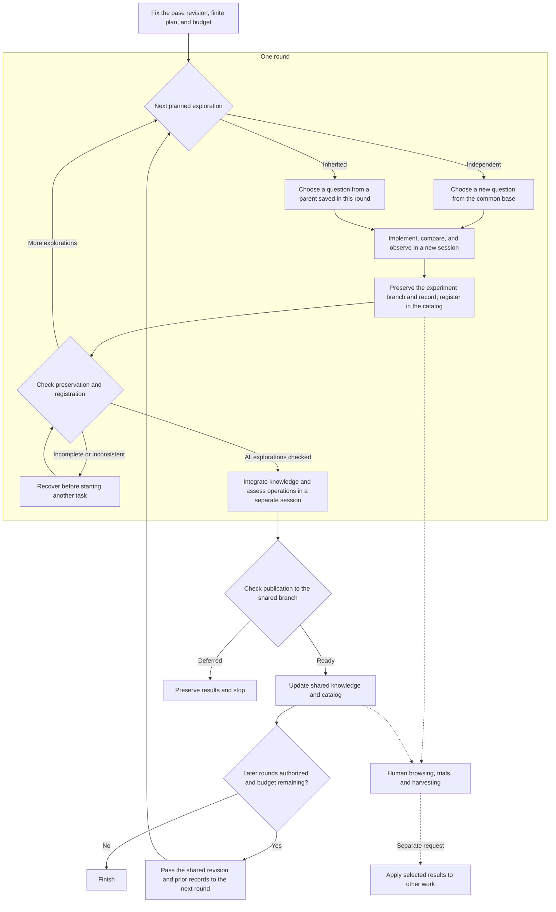

# Exploration through harvesting

[Documentation](../README.md) / Concepts

mutagi helps agents investigate questions, develop results and knowledge, and let people harvest useful parts for their own work.

| Activity | What it leaves behind |
| --- | --- |
| Exploration | An implementation, comparison, or counterexample testing one question, with results and limitations |
| Preservation | Fixed revisions of code, inputs, observation records, and reproduction steps |
| Inheritance | A new question tested using a parent's saved revision, with a reference to that parent |
| Knowledge integration | Updated understanding, applicability conditions, competing hypotheses, and evidence across results |
| Harvesting | Code, ideas, or counterexamples selected by a person, with a decision about their intended use |

## Execution flow

The current CLI runner executes planned explorations sequentially and integrates knowledge in a separate session at the end of each round.
For a series of rounds, the integrated shared revision becomes the next round's starting point.
People can browse and harvest interesting code or ideas while exploration continues.

Solid arrows show execution flow; dotted arrows show optional human actions.
The independent/inherited split concerns starting revisions, not parallel execution.
Time or usage thresholds and operator interruption can stop execution mid-round, followed by preservation.
Successful preservation does not establish successful observation or human adoption.

Updating shared knowledge through integration and adopting selected implementations are separate decisions.
See the [harvesting guide](../guides/harvesting.md) to try results and [configuration](../reference/configuration.md) and [commands](../reference/commands.md) to run explorations.
